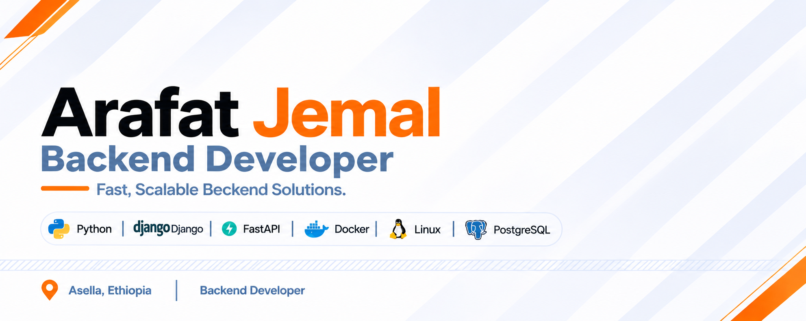

  <strong>Backend Developer | Python • Django • FastAPI</strong>

  Building reliable APIs and scalable backend systems.

---

## About

I'm Arafat Jemal, a backend developer focused on Python, API development, databases, and building maintainable software.

## Tech Stack

| Category | Technologies |
|---|---|
| Backend | Python, Django, FastAPI, REST APIs |
| Database | PostgreSQL, SQL |
| Frontend | JavaScript, Vue.js |
| Tools | Git, GitHub, Docker, Linux |
| Testing | Pytest |

## Currently Learning

Kubernetes, Kafka, RabbitMQ, AWS, distributed systems, and observability.

## Interests

Backend architecture, system design, event-driven systems, and scalable applications.

---

  <strong>Building. Learning. Improving.</strong>

